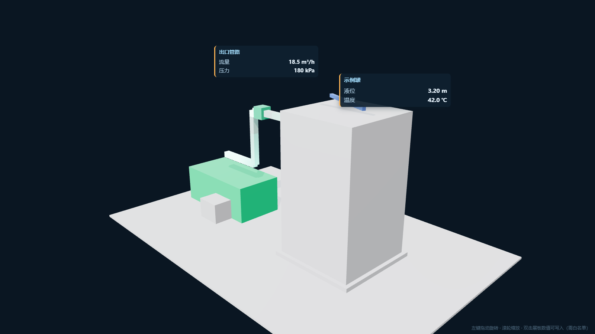
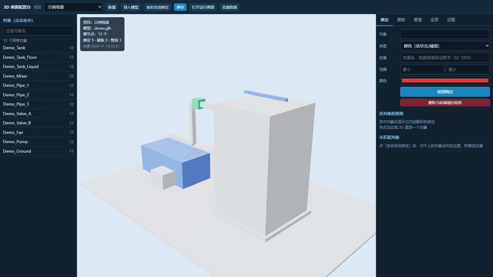
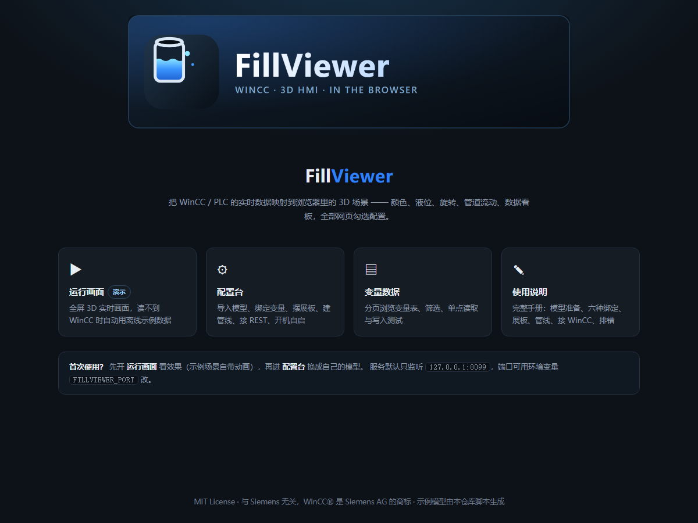

<p align="center">
  
</p>

# FillViewer · WinCC 3D 组态替代方案

把 **WinCC / PLC 的实时数据** 映射到一个 **浏览器里的 3D 场景**，用网页做工业 HMI 画面：
旋转、变色、液位升降、管道流动、数据看板、点击弹窗，全部通过勾选配置，不用写前端代码。

> 本项目与 Siemens 无关，是独立实现。WinCC® 是 Siemens 的商标；本仓库不含任何西门子二进制或公司私有模型。







## 为什么需要它

WinCC 自带的 3D 控件（WinCC 3D Control）只认 Collada，材质与光照难调、大模型卡顿、还要重复买许可。
FillViewer 换成 glTF + 现代浏览器：

| | WinCC 3D 控件 | FillViewer |
|---|---|---|
| 模型格式 | Collada (.dae) | **glTF/GLB**（Blender 直接导出） |
| 材质 | 受限 | PBR 全支持 |
| 动画 | 只能整体旋转/位移/缩放 | 旋转、渐变、液位、**管道流动**、闪烁 |
| 大场景 | 易卡 | 合并 draw call、静态阴影、帧率上限 |
| 配置方式 | 改脚本 | **网页配置台勾选** |
| 客户端 | 每台装授权 | 任意现代浏览器 |

## 功能

- **绑定（bindings）**：对象 → 变量，类型有 `颜色(阈值)` / `颜色渐变` / `缩放(液位)` / `旋转` / `旋转动画(启停+调速)` / `状态规则(多变量→颜色)`，支持闪烁、轴选择、正反转、固定数值（不接 PLC 也能演示）。
- **展板（panels）**：贴在设备上的数据卡片，动态显示数值，可选单位/小数/千分位，可限定"变量=0 时隐藏"。
- **管道流动（pipes）**：选中若干管道对象 → 走一条发光粒子带，速度可跟随流量变量；自动拟合弯头中心线（弯曲管道也能正确扫过）。
- **变量数据页**：分页浏览 4000+ 变量、筛选、单点读取、写入测试。
- **版本历史**：每次保存自动整项目快照，可随时回滚。
- **运行选项**：开机自启（用户级 / 计划任务）、启动后自动开画面、kiosk 全屏、一键生成 `FillViewer.exe`。
- **离线可跑**：读不到 WinCC REST 时自动回落到 `data/data.json`（WinCC 全局脚本定时写），本仓库自带示例数据。

## 快速开始

需要 Python 3.9+（只用标准库，无第三方依赖）。

```bash
git clone <this-repo> FillViewer
cd FillViewer
python server.py
# 浏览器打开 http://127.0.0.1:8099/
```

Windows 也可以双击 `run.cmd`。默认端口 8099，可用环境变量改：

```bash
set FILLVIEWER_PORT=8100      # Windows
FILLVIEWER_PORT=8100 python server.py   # Linux/macOS
```

打开后首页是 `index.html`，四个入口：

- `app/runtime.html?p=demo` —— 运行画面（演示场景）
- `app/studio.html` —— 配置台（绑定 / 展板 / 管道 / 设置）
- `app/vardata.html` —— 变量数据页
- `docs/使用说明.md` —— **完整使用手册**（也提供 `docs/使用说明.docx` 下载）

## 目录结构

```
index.html                首页入口（四个卡片：运行画面 / 配置台 / 变量数据 / 使用说明）
server.py                 本地服务（静态文件 + REST 代理 + 配置 API）
app/runtime.html          运行画面
app/studio.html           配置台
app/vardata.html          变量数据页
js/pipeflow.js            管道流动着色器实现
js/three.module.js        three.js r162（含 addons）
data/vartable.json        变量表（示例 8 个 Demo_*）
data/data.json            离线数据（REST 不可用时用它）
projects/demo/            project.json + bindings/panels/pipes + model/demo.glb
docs/                     使用说明（md + docx）/ 操作手册 / WinCC REST 教程 / Postman 教程 / 管道动画说明
wincc/                    WinCC 侧 VBS 脚本（把变量定时写到 data/data.json）
config.example.json       配置模板（复制成 config.json 再改）
```

## 五步做出自己的画面

1. **导出模型**：Blender 里按设备层级命名对象 → 导出 `.glb` → 放到 `projects/<项目>/model/`。
2. **建项目**：配置台右上「新建」→ 填项目名 → 选模型。
3. **绑定**：左侧点对象（或 3D 里点实体）→ 右侧选类型、填变量 → 「加到绑定」。
4. **展板/管道**：展板页加行、拖动摆位；管道页多选管道对象 → 建管线。
5. **保存** → 打开运行画面。每次保存都会自动存一份版本历史。

## 接 WinCC

1. WinCC 计算机属性里勾选 **REST 服务**（需 REST 许可；WinCC V8.x）。默认 `https://<主机>:8092/WinCCRestService`。
2. 把 `config.example.json` 复制为 `config.json`，改成你的主机/账号：
   ```json
   { "restBase": "https://YOUR-WINCC-HOST:8092/WinCCRestService",
     "restUser": "YOUR-USER", "restPass": "YOUR-PASSWORD" }
   ```
3. 变量名直接用 WinCC 的变量名（含中文也没问题）。
4. 不想开 REST：用 `wincc/` 里的 VBS 全局脚本，把变量周期写到 `data/data.json`，页面自动改用文件数据源。

详细步骤见 `docs/WinCC_REST服务使用教程_v2.md` 与 `docs/Postman使用教程.md`（含可直接导入的 Postman 集合）。

## 已知限制

- 只支持 **glTF/GLB**；Collada 需先转。
- 对象名必须与模型节点名一致；Blender 里改名后要重新导出并重新绑定。
- 变量写入需要 WinCC 侧给该变量开 REST 写权限（否则返回 `Forbidden`，HTTP 仍是 200，要看 `errorcode`）。
- 目前是单机单用户配置，没有账号体系；请只在本机/内网使用。

## 许可

MIT，见 [LICENSE](LICENSE)。示例模型 `projects/demo/model/demo.glb` 由本仓库脚本生成，可自由使用。


## English

FillViewer turns **WinCC/PLC live data** into a **3D HMI in the browser**: rotate, tint, fill level,
pipe flow, data cards and click-through popups, all configured in a web UI — no frontend coding.

- glTF/GLB models (export straight from Blender), PBR materials
- Bindings: threshold color, gradient, level scale, rotation, spin with speed, multi-variable state rules
- Pipe flow with automatic elbow-aware centerline fitting
- Works offline: falls back to `data/data.json` written by a WinCC VBS script
- Pure Python stdlib; `python server.py` and open http://127.0.0.1:8099/

MIT licensed. Not affiliated with Siemens; WinCC is a trademark of Siemens AG.
